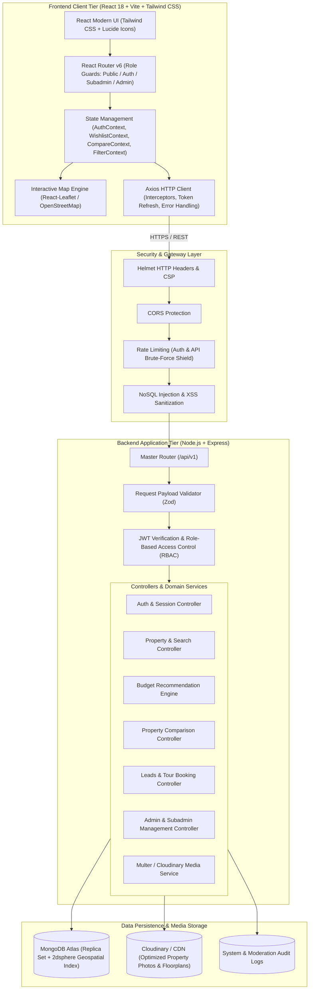
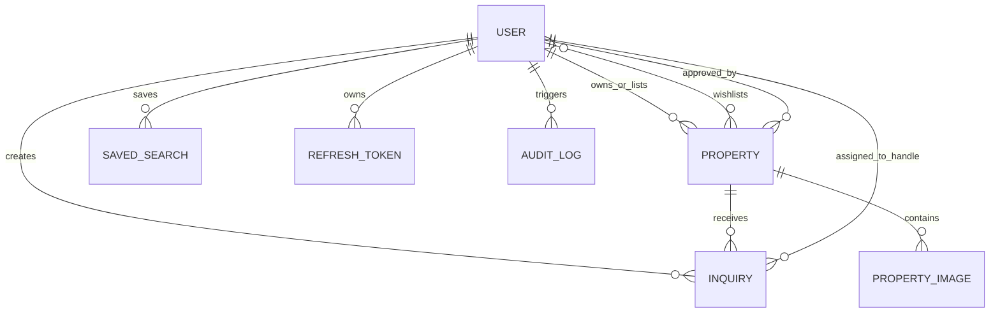
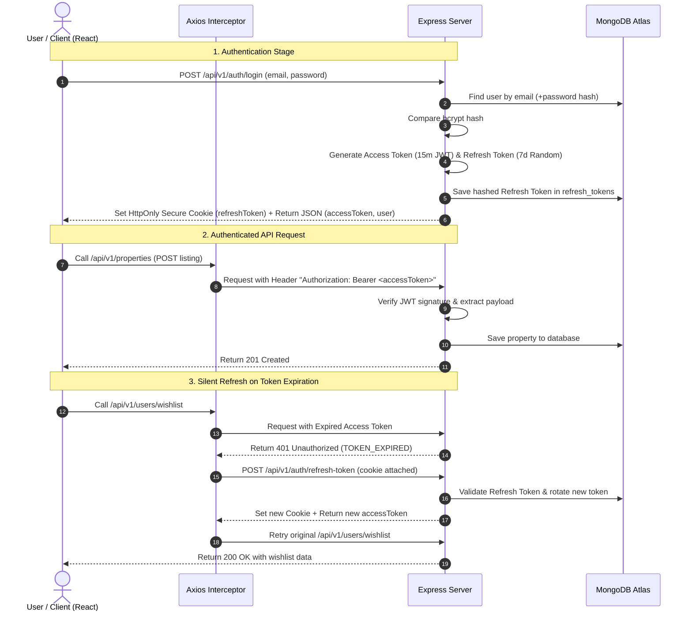
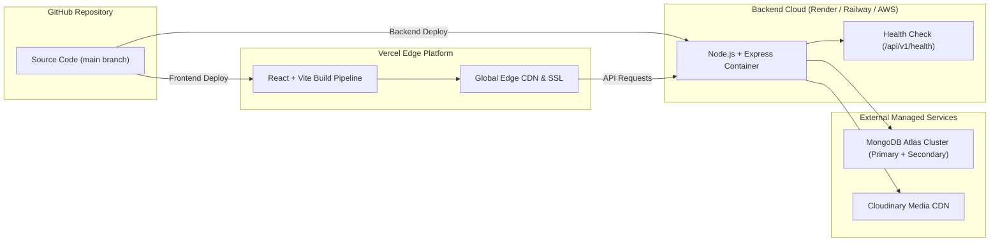

# SV-RoyalEstate: Production Real Estate Web Application
## Master Architecture, System Design & Technical Implementation Plan

---

## Executive Summary
**SV-RoyalEstate** is a modern, dynamic, full-stack real estate platform engineered to democratize property discovery. It solves the fragmentation and high friction in finding budget-friendly land, houses, flats, apartments, and commercial spaces. By combining **Smart Multi-Criteria Search**, **Geospatial Interactive Mapping**, **Budget-Based Intelligent Recommendations**, **Side-by-Side Property Comparison**, and **Multi-Tier Dynamic Admin Governance (Admin, Subadmin, User)**, SV-RoyalEstate delivers a seamless experience for buyers, renters, owners, agents, and platform administrators.

---

## 1. Complete Project Architecture

### 1.1 High-Level Architecture Overview
SV-RoyalEstate is architected as a modular, decoupled **Client-Server RESTful Web Application** designed for high throughput, sub-100ms search responses, and zero-downtime scalability.



### 1.2 Data Flow Architecture
1. **Property Discovery & Search**: Client submits filter params (budget range, location, radius, property type, BHK, amenities) $\rightarrow$ Backend executes MongoDB compound aggregation with `$geoNear` / `$match` / `$facet` for instantaneous pagination and facet counts $\rightarrow$ Returns structured JSON with geospatial markers and price badges.
2. **Budget-Based Recommendation Flow**: User inputs maximum budget and preferred property type/location $\rightarrow$ Recommendation service evaluates:
   - Within-budget matches ($P \le \text{Budget}_{\max}$)
   - High-value opportunities in neighboring localities ($0.8 \times \text{Budget}_{\max} \le P \le 1.05 \times \text{Budget}_{\max}$)
   - Best price-per-square-foot ratios and verified status boost
   - EMI calculation estimation based on current interest rates.
3. **Property Comparison Flow**: Client adds up to 4 properties to `CompareContext` $\rightarrow$ Fetches standardized schema metrics $\rightarrow$ Renders side-by-side attribute matrix highlighting pricing differentials, area, amenities, construction status, and location metrics.
4. **Moderation & Admin Approval Workflow**: User/Agent creates listing $\rightarrow$ Listing status set to `PENDING_APPROVAL` $\rightarrow$ Subadmin/Admin receives notification on moderation queue $\rightarrow$ Reviews specs, media, legal clearances (RERA/Title) $\rightarrow$ Approves (transitions to `APPROVED` and appears live) or Rejects (with mandatory rejection feedback notes).

---

## 2. Frontend Folder Structure (React + Vite + Tailwind CSS)

```
frontend/
├── .env.example
├── .eslintrc.cjs
├── index.html
├── package.json
├── postcss.config.js
├── tailwind.config.js
├── vite.config.js
└── src/
    ├── main.jsx                          # App bootstrap with React DOM
    ├── App.jsx                           # Master route & context providers
    ├── index.css                         # Tailwind CSS base, components, utilities
    │
    ├── assets/                           # Static assets, logos, fallback banners
    │   ├── images/
    │   │   ├── hero-bg.jpg
    │   │   ├── property-placeholder.jpg
    │   │   └── logo.svg
    │   └── icons/
    │
    ├── config/                           # Application configuration constants
    │   ├── api.config.js                 # API base URLs and timeout configs
    │   ├── constants.js                  # Property types, amenities lists, roles
    │   └── map.config.js                 # Default map center, zoom, tile layers
    │
    ├── context/                          # Global React State Providers
    │   ├── AuthContext.jsx               # Current user, login, register, logout, token
    │   ├── FilterContext.jsx             # Active search queries, budget slider, location
    │   ├── CompareContext.jsx            # Selected properties for side-by-side comparison
    │   ├── WishlistContext.jsx           # Favorite properties synchronization
    │   └── ToastContext.jsx              # Toast notification queue
    │
    ├── hooks/                            # Custom React Hooks
    │   ├── useAuth.js                    # Auth context consumer
    │   ├── useProperties.js              # Property fetching, caching, pagination
    │   ├── useDebounce.js                # Input debouncing for search bars
    │   ├── useGeolocation.js             # User device GPS coordinate resolver
    │   ├── useEmiCalculator.js           # Mortgage / EMI calculation logic
    │   └── useLocalStorage.js            # LocalStorage persistence hook
    │
    ├── layouts/                          # Page Layout Containers
    │   ├── RootLayout.jsx                # Global navbar, main content, footer
    │   ├── AuthLayout.jsx                # Centered authentication card container
    │   ├── DashboardLayout.jsx           # User account portal sidebar + content
    │   └── AdminLayout.jsx               # Admin / Subadmin management shell
    │
    ├── routes/                           # Routing Architecture & Protection Guards
    │   ├── AppRoutes.jsx                 # Master application router tree
    │   ├── ProtectedRoute.jsx            # Authenticated user route guard
    │   ├── SubadminRoute.jsx             # Subadmin & Admin role route guard
    │   └── AdminRoute.jsx                # Super Admin exclusive route guard
    │
    ├── services/                         # Axios API Communication Services
    │   ├── api.js                        # Axios instance with auth & refresh interceptors
    │   ├── auth.service.js               # Login, Register, Refresh, Logout, Profile
    │   ├── property.service.js           # Query, GetById, Create, Update, Delete
    │   ├── recommendation.service.js     # Budget recommendations & deals
    │   ├── inquiry.service.js            # Submit leads, schedule tours, status updates
    │   ├── admin.service.js              # User management, approvals, platform stats
    │   └── upload.service.js             # Image and document upload service
    │
    ├── components/                       # Reusable UI Component Library
    │   ├── common/                       # Atomic Base Components
    │   │   ├── Button.jsx                # Primary, Secondary, Outline, Danger variants
    │   │   ├── Input.jsx                 # Form text/number inputs with validation states
    │   │   ├── Select.jsx                # Custom dropdown selector
    │   │   ├── RangeSlider.jsx           # Dual-thumb budget and area slider
    │   │   ├── Modal.jsx                 # Accessible dialog modal
    │   │   ├── Badge.jsx                 # Verified, Status, Featured badges
    │   │   ├── Card.jsx                  # Versatile container card
    │   │   ├── Spinner.jsx               # Loading spinner & skeleton loaders
    │   │   └── Pagination.jsx            # Dynamic pagination controls
    │   │
    │   ├── property/                     # Property Domain Components
    │   │   ├── PropertyCard.jsx          # Property grid/list preview card
    │   │   ├── PropertyGrid.jsx          # Responsive property showcase grid
    │   │   ├── PropertyFilters.jsx       # Advanced filter panel (budget, type, BHK)
    │   │   ├── PropertyGallery.jsx       # Lightbox image slider & thumbnail viewer
    │   │   ├── PropertySpecs.jsx         # Floorplan, dimensions, facing, age
    │   │   ├── PropertyLocationMap.jsx   # Single property Leaflet location pin
    │   │   ├── EmiCalculatorWidget.jsx   # Interactive loan & EMI estimation widget
    │   │   └── InquiryFormModal.jsx      # Schedule tour / Contact owner modal
    │   │
    │   ├── map/                          # Geospatial Map Components
    │   │   ├── InteractiveMap.jsx        # Fullscreen / split view Leaflet map
    │   │   ├── MapMarker.jsx             # Custom price-tagged property pins
    │   │   ├── MapCluster.jsx            # Clustered marker groupings
    │   │   └── RadiusFilterControl.jsx   # Distance radius search slider
    │   │
    │   ├── compare/                      # Comparison Domain Components
    │   │   ├── CompareDrawer.jsx         # Sticky bottom bar of selected properties
    │   │   ├── CompareTable.jsx          # Comprehensive comparison matrix
    │   │   └── SpecDifferenceHighlight.jsx# Difference detector toggle
    │   │
    │   ├── navigation/                   # Headers, Navbars, Footers
    │   │   ├── Navbar.jsx                # Responsive navigation with search & profile
    │   │   ├── MobileNav.jsx             # Off-canvas mobile navigation drawer
    │   │   ├── Footer.jsx                # SEO links, newsletter, company info
    │   │   └── AdminSidebar.jsx          # Admin & Subadmin sidebar navigation
    │   │
    │   └── feedback/                     # Feedback & Alerts
    │       ├── Toast.jsx                 # Toast notification items
    │       ├── EmptyState.jsx            # "No properties found" placeholder
    │       └── ConfirmDialog.jsx         # Destructive action verification dialog
    │
    ├── features/                         # Modular Page & Feature Views
    │   ├── home/                         # Landing Page
    │   │   ├── components/               # HeroSearch, FeaturedSection, CategoryCarousel
    │   │   └── pages/HomePage.jsx
    │   │
    │   ├── properties/                   # Public Property Browsing & Details
    │   │   ├── pages/PropertyListPage.jsx    # Split-screen search, filter, and map list
    │   │   ├── pages/PropertyDetailPage.jsx  # Detailed listing specs, gallery, tour
    │   │   └── pages/PropertyComparePage.jsx # Multi-property side-by-side comparison
    │   │
    │   ├── recommendations/              # Budget Discovery Engine
    │   │   └── pages/BudgetFinderPage.jsx    # Dedicated budget-based discovery wizard
    │   │
    │   ├── user/                         # User Portal (Buyer / Owner / Agent)
    │   │   ├── pages/UserDashboardPage.jsx   # Inquiries, saved searches, stats
    │   │   ├── pages/UserWishlistPage.jsx    # Bookmarked properties
    │   │   ├── pages/UserMyListingsPage.jsx  # Submitted properties & status
    │   │   ├── pages/AddEditPropertyPage.jsx # Multi-step property submission wizard
    │   │   └── pages/UserProfilePage.jsx     # Profile & security settings
    │   │
    │   ├── admin/                        # Admin & Subadmin Portal
    │   │   ├── pages/AdminDashboardPage.jsx  # Key platform metrics & analytics charts
    │   │   ├── pages/AdminPropertiesPage.jsx # Moderation queue (Approve/Reject/Edit)
    │   │   ├── pages/AdminUsersPage.jsx      # User & Subadmin management & roles
    │   │   ├── pages/AdminInquiriesPage.jsx  # Lead pipeline & tour assignment
    │   │   └── pages/AdminAuditLogsPage.jsx  # Audit log telemetry viewer
    │   │
    │   └── auth/                         # Authentication Views
    │       ├── pages/LoginPage.jsx
    │       ├── pages/RegisterPage.jsx
    │       └── pages/ForgotPasswordPage.jsx
    │
    └── utils/                           # Client Helpers
        ├── formatters.js                 # Price (INR/USD/Lakhs/Crores), Area, Date
        ├── validators.js                 # Form schema validation utilities
        └── seo.js                        # Document title & meta tag updater
```

---

## 3. Backend Folder Structure (Node.js + Express)

```
backend/
├── .env.example
├── .gitignore
├── package.json
├── server.js                             # Server startup, port binding, graceful shutdown
└── src/
    ├── app.js                            # Express app configuration & middleware pipeline
    │
    ├── config/                           # Environment & Third-Party Configurations
    │   ├── db.config.js                  # Mongoose MongoDB connection & event hooks
    │   ├── jwt.config.js                 # JWT secret keys, salt rounds, token TTLs
    │   └── cloudinary.config.js          # Cloudinary media storage SDK setup
    │
    ├── constants/                        # Domain Constants & Enums
    │   ├── roles.js                      # 'ADMIN', 'SUBADMIN', 'USER'
    │   ├── propertyEnums.js              # Types (FLAT, VILLA, PLOT, COMMERCIAL), Statuses
    │   ├── httpStatusCodes.js            # Standardized HTTP status response codes
    │   └── errorCodes.js                 # Application-specific error codes
    │
    ├── controllers/                      # Request & Response Handlers
    │   ├── auth.controller.js            # Register, Login, Refresh, Logout, Current User
    │   ├── property.controller.js        # Public CRUD, Filtering, Map Query, Detail View
    │   ├── recommendation.controller.js  # Smart Budget Matching & Best Value Engine
    │   ├── compare.controller.js         # Multi-property specification comparison
    │   ├── inquiry.controller.js         # Lead submission, tour scheduling, lead management
    │   ├── user.controller.js            # Profile, wishlist toggle, user listing management
    │   ├── admin.controller.js           # Property approvals, user roles, platform metrics
    │   └── upload.controller.js          # Multi-image & floorplan upload handler
    │
    ├── middlewares/                      # Express Middleware Pipeline
    │   ├── auth.middleware.js            # JWT verification & token extraction
    │   ├── rbac.middleware.js            # Role-Based Access Control (Admin, Subadmin, User)
    │   ├── validate.middleware.js        # Zod request body/query schema validation
    │   ├── rateLimiter.middleware.js     # DDoS & Brute-Force rate limiters
    │   ├── upload.middleware.js          # Multer memory storage & file type filters
    │   └── error.middleware.js           # Centralized global error handling & formatting
    │
    ├── models/                           # Mongoose Schemas & Models
    │   ├── User.model.js                 # User account, role, preferences, wishlist
    │   ├── Property.model.js             # Property listing with 2dsphere geospatial index
    │   ├── Inquiry.model.js              # Inquiries, tour requests, and lead management
    │   ├── Review.model.js               # Property and agent reviews & ratings
    │   ├── SavedSearch.model.js          # User saved filters and budget alerts
    │   ├── AuditLog.model.js             # Administrative and moderation audit trail
    │   └── RefreshToken.model.js         # Refresh token rotation tracking
    │
    ├── routes/                           # API Route Definitions
    │   ├── index.js                      # Root router aggregating /api/v1 endpoints
    │   ├── auth.routes.js                # Auth routes (/api/v1/auth)
    │   ├── property.routes.js            # Property routes (/api/v1/properties)
    │   ├── recommendation.routes.js      # Recommendations (/api/v1/recommendations)
    │   ├── inquiry.routes.js             # Inquiries & tours (/api/v1/inquiries)
    │   ├── user.routes.js                # User profile & my-listings (/api/v1/users)
    │   ├── admin.routes.js               # Admin & Subadmin portal (/api/v1/admin)
    │   └── upload.routes.js              # Media upload routes (/api/v1/uploads)
    │
    ├── services/                         # Business Logic Service Layer
    │   ├── auth.service.js               # Password hashing, JWT signing & verification
    │   ├── property.service.js           # Complex aggregation, geospatial queries, CRUD
    │   ├── recommendation.service.js     # Budget ranking & recommendation heuristics
    │   ├── inquiry.service.js            # Lead assignment and tour notification
    │   ├── admin.service.js              # Platform telemetry, approval pipeline, audits
    │   └── email.service.js              # Email notification service (Nodemailer / Resend)
    │
    ├── validations/                      # Zod Validation Schemas
    │   ├── auth.validation.js            # Login, register, password change schemas
    │   ├── property.validation.js        # Property listing creation, update, query schemas
    │   ├── inquiry.validation.js         # Tour booking and lead submission schemas
    │   └── user.validation.js            # Profile updates and role assignment schemas
    │
    └── utils/                            # Server Utilities & Helpers
        ├── ApiError.js                   # Custom Operational API Error class
        ├── ApiResponse.js                # Standardized JSON response envelope
        ├── asyncHandler.js               # Async controller wrapper for unhandled promises
        ├── slugify.js                    # URL-friendly slug generator for properties
        └── geoUtils.js                   # Coordinate validation & bounding box utilities
```

---

## 4. Database Collections & Schemas (MongoDB / Mongoose)

### 4.1 `users` Collection
Stores user profiles, roles, authentication credentials, and user preferences.
- `_id`: `ObjectId` (Primary Key)
- `firstName`: `String` (Required, Trim, Max: 50)
- `lastName`: `String` (Required, Trim, Max: 50)
- `email`: `String` (Required, Unique, Lowercase, Indexed)
- `password`: `String` (Required, Hashed via bcryptjs, select: false)
- `phone`: `String` (Optional, Trim, Indexed)
- `role`: `String` (`'ADMIN' | 'SUBADMIN' | 'USER'`, Default: `'USER'`, Indexed)
- `avatar`: `String` (Default: placeholder avatar URL)
- `wishlist`: `[{ type: ObjectId, ref: 'Property' }]` (Indexed array)
- `isVerified`: `Boolean` (Default: `false`)
- `isActive`: `Boolean` (Default: `true`, Indexed)
- `isBanned`: `Boolean` (Default: `false`)
- `banReason`: `String` (Optional)
- `lastLoginAt`: `Date`
- `createdAt` / `updatedAt`: `Date` (Timestamps)

### 4.2 `properties` Collection
Core property listing schema with geospatial coordinate indexing for ultra-fast location queries.
- `_id`: `ObjectId` (Primary Key)
- `title`: `String` (Required, Trim, Max: 200, Text Indexed)
- `slug`: `String` (Required, Unique, Lowercase, Indexed)
- `description`: `String` (Required, Max: 5000, Text Indexed)
- `propertyType`: `String` (`'FLAT' | 'HOUSE_VILLA' | 'PLOT_LAND' | 'COMMERCIAL' | 'AGRICULTURAL' | 'PENTHOUSE'`, Required, Indexed)
- `listingType`: `String` (`'FOR_SALE' | 'FOR_RENT' | 'FOR_LEASE'`, Required, Indexed)
- `price`: `Number` (Required, Min: 0, Indexed)
- `pricePerSqFt`: `Number` (Computed, Min: 0, Indexed)
- `currency`: `String` (Default: `'INR'`)
- `isPriceNegotiable`: `Boolean` (Default: `false`)
- `areaSqFt`: `Number` (Required, Min: 1, Indexed)
- `carpetAreaSqFt`: `Number` (Optional, Min: 1)
- `bedrooms`: `Number` (Required for residential, Min: 0, Default: 0, Indexed — e.g., 1, 2, 3 BHK)
- `bathrooms`: `Number` (Min: 0, Default: 0)
- `balconies`: `Number` (Min: 0, Default: 0)
- `furnishingStatus`: `String` (`'UNFURNISHED' | 'SEMI_FURNISHED' | 'FULLY_FURNISHED'`, Default: `'UNFURNISHED'`, Indexed)
- `constructionStatus`: `String` (`'READY_TO_MOVE' | 'UNDER_CONSTRUCTION' | 'NEW_LAUNCH' | 'RESALE'`, Required, Indexed)
- `possessionDate`: `Date` (Optional)
- `yearBuilt`: `Number` (Optional)
- `floorNumber`: `Number` (Optional)
- `totalFloors`: `Number` (Optional)
- `facingDirection`: `String` (`'NORTH' | 'SOUTH' | 'EAST' | 'WEST' | 'NORTH_EAST' | 'NORTH_WEST' | 'SOUTH_EAST' | 'SOUTH_WEST'`)
- `location`:
  - `address`: `String` (Required, Max: 300)
  - `locality`: `String` (Required, Trim, Indexed)
  - `city`: `String` (Required, Trim, Indexed)
  - `state`: `String` (Required, Trim, Indexed)
  - `pincode`: `String` (Required, Trim, Indexed)
  - `coordinates`:
    - `type`: `String` (`'Point'`, Default: `'Point'`)
    - `coordinates`: `[Number]` (Array: `[longitude, latitude]`, Required, **`2dsphere` Geospatial Index**)
- `amenities`: `[String]` (Array of amenities: e.g., `['PARKING', 'SWIMMING_POOL', 'GYM', '24X7_SECURITY', 'POWER_BACKUP', 'LIFT', 'GARDEN', 'CLUBHOUSE', 'CCTV', 'RAINWATER_HARVESTING']`, Indexed)
- `images`: `[{ url: String, publicId: String, isFeatured: Boolean, caption: String }]` (Required, Min: 1 image)
- `floorPlans`: `[{ url: String, title: String }]`
- `virtualTourUrl`: `String` (Optional)
- `legalClearances`:
  - `reraApproved`: `Boolean` (Default: `false`, Indexed)
  - `reraId`: `String` (Optional)
  - `bankLoanAvailable`: `Boolean` (Default: `false`)
  - `clearTitle`: `Boolean` (Default: `true`)
- `status`: `String` (`'DRAFT' | 'PENDING_APPROVAL' | 'APPROVED' | 'REJECTED' | 'SOLD' | 'RENTED'`, Default: `'PENDING_APPROVAL'`, Indexed)
- `rejectionReason`: `String` (Optional)
- `isFeatured`: `Boolean` (Default: `false`, Indexed)
- `isVerified`: `Boolean` (Default: `false`, Indexed)
- `viewsCount`: `Number` (Default: 0, Indexed)
- `inquiriesCount`: `Number` (Default: 0)
- `ownerId`: `ObjectId` (Ref: `'User'`, Required, Indexed)
- `approvedBy`: `ObjectId` (Ref: `'User'`, Optional)
- `approvedAt`: `Date` (Optional)
- `createdAt` / `updatedAt`: `Date` (Timestamps, Indexed)

### 4.3 `inquiries` Collection (Leads & Tour Bookings)
- `_id`: `ObjectId` (Primary Key)
- `propertyId`: `ObjectId` (Ref: `'Property'`, Required, Indexed)
- `userId`: `ObjectId` (Ref: `'User'`, Optional — if visitor is logged in, Indexed)
- `visitorName`: `String` (Required, Trim, Max: 100)
- `visitorEmail`: `String` (Required, Trim, Lowercase)
- `visitorPhone`: `String` (Required, Trim)
- `inquiryType`: `String` (`'GENERAL_INQUIRY' | 'PRICE_NEGOTIATION' | 'SCHEDULE_TOUR' | 'CALLBACK_REQUEST'`, Default: `'GENERAL_INQUIRY'`)
- `preferredTourDate`: `Date` (Optional)
- `preferredTourTimeSlot`: `String` (e.g., `'10:00 AM - 12:00 PM'`)
- `tourMode`: `String` (`'IN_PERSON' | 'VIDEO_CALL'`, Default: `'IN_PERSON'`)
- `message`: `String` (Required, Max: 1000)
- `status`: `String` (`'NEW' | 'CONTACTED' | 'TOUR_SCHEDULED' | 'NEGOTIATION' | 'CLOSED' | 'SPAM'`, Default: `'NEW'`, Indexed)
- `assignedTo`: `ObjectId` (Ref: `'User'` - Subadmin/Agent, Optional, Indexed)
- `adminNotes`: `String` (Internal notes)
- `createdAt` / `updatedAt`: `Date` (Timestamps)

### 4.4 `saved_searches` Collection (Budget Alerts)
- `_id`: `ObjectId` (Primary Key)
- `userId`: `ObjectId` (Ref: `'User'`, Required, Indexed)
- `name`: `String` (e.g. "2BHK Under 50 Lakhs in City Center")
- `filters`:
  - `minPrice`: `Number`
  - `maxPrice`: `Number`
  - `city`: `String`
  - `locality`: `String`
  - `propertyType`: `[String]`
  - `bedrooms`: `[Number]`
- `isEmailAlertEnabled`: `Boolean` (Default: `true`)
- `lastNotifiedAt`: `Date`
- `createdAt` / `updatedAt`: `Date` (Timestamps)

### 4.5 `audit_logs` Collection (Platform & Moderation Audit Trail)
- `_id`: `ObjectId` (Primary Key)
- `actorId`: `ObjectId` (Ref: `'User'`, Required, Indexed)
- `action`: `String` (Required: `'PROPERTY_APPROVED'`, `'PROPERTY_REJECTED'`, `'USER_ROLE_CHANGED'`, `'PROPERTY_DELETED'`, `'USER_BANNED'`, etc.)
- `entityType`: `String` (`'Property' | 'User' | 'Inquiry' | 'System'`)
- `entityId`: `ObjectId` (Required, Indexed)
- `previousState`: `Object`
- `newState`: `Object`
- `ipAddress`: `String`
- `userAgent`: `String`
- `createdAt`: `Date` (Indexed, TTL: 90 Days)

### 4.6 `refresh_tokens` Collection
- `_id`: `ObjectId` (Primary Key)
- `userId`: `ObjectId` (Ref: `'User'`, Required, Indexed)
- `token`: `String` (Hashed refresh token, Unique, Indexed)
- `expiresAt`: `Date` (Required, TTL Index)
- `isRevoked`: `Boolean` (Default: `false`)
- `ipAddress`: `String`
- `userAgent`: `String`

---

## 5. Database Relationships (ERD)



---

## 6. Complete API Endpoints Specification

All API routes are mounted under `/api/v1`.

### 6.1 Authentication API (`/api/v1/auth`)
| Method | Endpoint | Description | Auth Required |
| :--- | :--- | :--- | :---: |
| `POST` | `/auth/register` | Register new user (Buyer/Owner) with JWT & Cookie | Public |
| `POST` | `/auth/login` | Authenticate with email/password; returns Access Token + Refresh Cookie | Public |
| `POST` | `/auth/refresh-token` | Rotate Refresh Token & issue fresh Access Token | Cookie |
| `POST` | `/auth/logout` | Invalidate Refresh Token session & clear Cookie | Authenticated |
| `GET` | `/auth/me` | Fetch active user credentials, role, & wishlist IDs | Authenticated |

### 6.2 Public Properties & Search API (`/api/v1/properties`)
| Method | Endpoint | Description | Auth Required |
| :--- | :--- | :--- | :---: |
| `GET` | `/properties` | Smart search & filtering with pagination, sorting & facets | Public |
| `GET` | `/properties/map` | Lightweight geospatial query returning map pins & coordinates | Public |
| `GET` | `/properties/featured` | Fetch top featured & verified properties | Public |
| `GET` | `/properties/:slug` | Retrieve full property details, owner info, & increment views | Public |
| `POST` | `/properties` | Submit new property listing (defaults to `PENDING_APPROVAL`) | Authenticated |
| `PUT` | `/properties/:id` | Update own property listing | Owner / Admin |
| `DELETE` | `/properties/:id` | Soft delete own property listing | Owner / Admin |

### 6.3 Smart Recommendations & Budget Discovery API (`/api/v1/recommendations`)
| Method | Endpoint | Description | Auth Required |
| :--- | :--- | :--- | :---: |
| `GET` | `/recommendations/budget` | Smart budget recommendation matching input budget & locality | Public |
| `GET` | `/recommendations/similar/:id`| Find similar properties (price range, BHK, locality) | Public |
| `GET` | `/recommendations/best-value` | Discover best value-for-money deals (low price/sqft + verified) | Public |

### 6.4 Property Comparison API (`/api/v1/compare`)
| Method | Endpoint | Description | Auth Required |
| :--- | :--- | :--- | :---: |
| `POST` | `/compare/properties` | Fetch side-by-side spec comparison for up to 4 property IDs | Public |

### 6.5 Inquiries & Tour Bookings API (`/api/v1/inquiries`)
| Method | Endpoint | Description | Auth Required |
| :--- | :--- | :--- | :---: |
| `POST` | `/inquiries` | Submit property inquiry or schedule a tour | Public |
| `GET` | `/inquiries/my-inquiries`| Get inquiries submitted by current user | Authenticated |
| `GET` | `/inquiries/property/:id`| Get inquiries received for user's own property | Owner / Subadmin |

### 6.6 User Management & Wishlist API (`/api/v1/users`)
| Method | Endpoint | Description | Auth Required |
| :--- | :--- | :--- | :---: |
| `GET` | `/users/profile` | Get user profile and submitted listings count | Authenticated |
| `PUT` | `/users/profile` | Update user name, phone, avatar | Authenticated |
| `PUT` | `/users/change-password` | Update user password | Authenticated |
| `GET` | `/users/wishlist` | Fetch full populated list of bookmarked properties | Authenticated |
| `POST` | `/users/wishlist/:propertyId`| Add/Remove property from user's wishlist | Authenticated |
| `GET` | `/users/my-listings` | Get all properties listed by current user (with approval status) | Authenticated |

### 6.7 Admin & Subadmin Management API (`/api/v1/admin`)
| Method | Endpoint | Description | Auth Required |
| :--- | :--- | :--- | :---: |
| `GET` | `/admin/metrics` | Total properties, users, leads, pending approvals, revenue stats | Subadmin / Admin |
| `GET` | `/admin/properties` | Moderation queue with filters (`PENDING`, `APPROVED`, `REJECTED`) | Subadmin / Admin |
| `PATCH` | `/admin/properties/:id/status`| Approve or Reject property listing with moderation notes | Subadmin / Admin |
| `PATCH` | `/admin/properties/:id/feature`| Toggle `isFeatured` / `isVerified` status | Subadmin / Admin |
| `GET` | `/admin/users` | Paginated user management table with search and role filters | Admin Only |
| `PATCH` | `/admin/users/:id/role` | Elevate or demote user role (`USER`, `SUBADMIN`, `ADMIN`) | Admin Only |
| `PATCH` | `/admin/users/:id/status` | Ban or unban user account with reason | Admin Only |
| `GET` | `/admin/inquiries` | All platform leads with assignment & status updates | Subadmin / Admin |
| `PATCH` | `/admin/inquiries/:id` | Update lead status (`CONTACTED`, `TOUR_SCHEDULED`, etc.) | Subadmin / Admin |
| `GET` | `/admin/audit-logs` | Platform-wide security and moderation audit logs | Admin Only |

### 6.8 Media Upload API (`/api/v1/uploads`)
| Method | Endpoint | Description | Auth Required |
| :--- | :--- | :--- | :---: |
| `POST` | `/uploads/images` | Multi-image upload for property gallery (with auto-compression) | Authenticated |
| `POST` | `/uploads/avatar` | Single avatar image upload | Authenticated |

---

## 7. Authentication Flow & Session Management



---

## 8. Authorization & Role-Based Access Control (RBAC)

### 8.1 Role Permission Matrix
SV-RoyalEstate supports 3 distinct, clearly separated user roles:

| Feature / Action | Public / Visitor | User (Buyer / Owner / Agent) | Subadmin | Admin (Super Admin) |
| :--- | :---: | :---: | :---: | :---: |
| Browse / Search Properties | ✅ | ✅ | ✅ | ✅ |
| View Interactive Map & Filters | ✅ | ✅ | ✅ | ✅ |
| Budget Recommendation Engine | ✅ | ✅ | ✅ | ✅ |
| Property Comparison Tool | ✅ | ✅ | ✅ | ✅ |
| Submit Inquiry / Schedule Tour | ✅ | ✅ | ✅ | ✅ |
| Bookmark / Wishlist Properties | ❌ | ✅ | ✅ | ✅ |
| Submit Property Listing | ❌ | ✅ (Pending Approval) | ✅ (Auto-Approved) | ✅ (Auto-Approved) |
| Manage Own Listings | ❌ | ✅ | ✅ | ✅ |
| Review Moderation Queue | ❌ | ❌ | ✅ | ✅ |
| Approve / Reject Listings | ❌ | ❌ | ✅ | ✅ |
| Toggle Verified / Featured Badges | ❌ | ❌ | ✅ | ✅ |
| Manage Platform Inquiries / Leads | ❌ | ❌ | ✅ | ✅ |
| View Platform Analytics & Metrics | ❌ | ❌ | ✅ (Read-Only) | ✅ (Full Telemetry) |
| Manage Users & Change Roles | ❌ | ❌ | ❌ | ✅ |
| Ban / Unban Accounts | ❌ | ❌ | ❌ | ✅ |
| View Security Audit Logs | ❌ | ❌ | ❌ | ✅ |
| System Configuration & DB Admin | ❌ | ❌ | ❌ | ✅ |

---

## 9. Admin & Subadmin Functionality

### 9.1 Dynamic Admin Dashboard
- **Executive KPI Cards**: Real-time counters for Total Active Listings, Total Users, Pending Approvals, Total Inquiries, and Monthly Valuation.
- **Moderation Workflow**:
  - Direct preview of submitted photos, specifications, address, and legal paperwork.
  - One-click **Approve** (instantly indexes and publishes listing to public search and map).
  - One-click **Reject** with structured feedback modal (e.g., "Inaccurate pricing", "Blurry images", "Missing RERA clearance").
- **Featured & Verified Booster**: Mark high-profile properties with "Verified" badge or promote them to the "Featured Showcase" on the homepage.

### 9.2 Subadmin Delegation
- Subadmins possess dedicated moderation privileges to review listings, resolve inquiries, and update tour statuses without access to sensitive financial metrics or user role modifications.

### 9.3 User & Access Management (Admin Exclusive)
- Searchable, filterable user database displaying registration dates, verified statuses, listings count, and role selectors (`USER`, `SUBADMIN`, `ADMIN`).
- Instant account suspension / ban toggle with audit log recording.

### 9.4 Telemetry & Audit Logs
- Immutable chronological log tracking every administrative action (who changed what, previous state, new state, IP address, timestamp).

---

## 10. User Functionality (Buyer, Renter, Owner, Agent)

### 10.1 Smart Search & Advanced Filters
- **Multi-Factor Filter Panel**:
  - Property Type: Flat/Apartment, House/Villa, Plot/Land, Commercial, Agricultural, Penthouse.
  - Budget Slider: Min/Max price with instant Indian numeric formatting (₹ Lakhs / Crores) or USD.
  - BHK Selector: 1 RK, 1 BHK, 2 BHK, 3 BHK, 4+ BHK.
  - Furnishing: Unfurnished, Semi-Furnished, Fully-Furnished.
  - Construction Status: Ready to Move, Under Construction, New Launch, Resale.
  - Amenities Checklist: Parking, Pool, Security, Gym, Power Backup, Lift, Garden.
  - Verified Listings Only toggle.
- **Smart Sorting**: Price (Low to High, High to Low), Newest First, Verified First, Most Popular.

### 10.2 Budget-Based Discovery Engine
- Dedicated **Budget Finder Wizard**: Enter your maximum investment budget $\rightarrow$ system computes affordability ranges, suggests primary matches, and highlights high-growth adjacent localities with superior price-per-square-foot metrics.
- Integrated **Interactive EMI Calculator**: Real-time calculation of monthly payments, down payments, interest rates, and loan tenure with dynamic principal vs. interest breakdown charts.

### 10.3 Interactive Map & Geospatial Search
- Interactive Leaflet map synchronized in real-time with search filters.
- Pins styled with exact property prices for rapid scanning.
- Interactive popups displaying thumbnail, title, BHK, area, and direct link to property.
- Radius search control (find properties within 5km, 10km, 25km of current location or landmark).

### 10.4 Side-by-Side Property Comparison
- Compare up to 4 properties simultaneously.
- Responsive tabular matrix comparing: Price, Price/sq.ft, Area, BHK, Bathrooms, Furnishing Status, Facing Direction, Floor Number, Amenities, RERA approval status, and Possession Date.
- "Highlight Differences" toggle for rapid evaluation.

### 10.5 Listing Submission & Management Portal
- Multi-step intuitive listing submission form with drag-and-drop photo upload, geospatial pin picker on map, amenity selector, and instant preview.
- Personal dashboard to track approval progress (`PENDING_APPROVAL`, `APPROVED`, `REJECTED`), edit details, or mark as `SOLD` / `RENTED`.

---

## 11. Required Environment Variables

### 11.1 Backend (`backend/.env`)
```env
# Application Server
NODE_ENV=development
PORT=5000
CLIENT_URL=http://localhost:5173

# Database
MONGODB_URI=mongodb+srv://<username>:<password>@cluster0.mongodb.net/sv_restate?retryWrites=true&w=majority

# JWT Authentication
JWT_ACCESS_SECRET=sv_restate_super_secure_access_secret_key_min_32_chars_2026
JWT_ACCESS_EXPIRES_IN=15m
JWT_REFRESH_SECRET=sv_restate_super_secure_refresh_secret_key_min_32_chars_2026
JWT_REFRESH_EXPIRES_IN=7d
COOKIE_SECRET=sv_restate_cookie_signing_secret_key_2026

# Cloudinary Media Storage (or S3)
CLOUDINARY_CLOUD_NAME=your_cloud_name
CLOUDINARY_API_KEY=your_api_key
CLOUDINARY_API_SECRET=your_api_secret

# Security & Rate Limiting
RATE_LIMIT_WINDOW_MS=900000
RATE_LIMIT_MAX=100
AUTH_RATE_LIMIT_MAX=10
```

### 11.2 Frontend (`frontend/.env`)
```env
VITE_APP_NAME="SV-RoyalEstate"
VITE_API_BASE_URL="http://localhost:5000/api/v1"
VITE_MAP_DEFAULT_LAT=12.9716
VITE_MAP_DEFAULT_LNG=77.5946
VITE_MAP_DEFAULT_ZOOM=12
```

---

## 12. Security Requirements & Hardening

1. **Helmet & HTTP Security Headers**: Content Security Policy (CSP), HTTP Strict Transport Security (HSTS), X-Frame-Options (`DENY`), X-Content-Type-Options (`nosniff`).
2. **CORS Whitelist Protection**: Strict origin verification restricting API access exclusively to the authorized frontend domain with `credentials: true`.
3. **NoSQL Injection & Parameter Pollution Defense**: Integration of `express-mongo-sanitize` and schema sanitization stripping prohibited `$` operators.
4. **Input Validation with Zod**: Strict type coercion and constraint checks on all incoming `req.body`, `req.query`, and `req.params`.
5. **Brute-Force & DDoS Mitigation**: `express-rate-limit` tiers for general API calls and heightened thresholds on authentication and lead submission routes.
6. **Secure Cookie Handling**: Refresh tokens encapsulated within `HttpOnly`, `Secure` (production), `SameSite=Strict` cookies immune to JavaScript extraction.
7. **Password Hashing**: Bcrypt with salt factor 12.

---

## 13. Deployment Architecture



- **Frontend Hosting**: Vercel with automatic continuous integration, optimized single-page application rewrites (`vercel.json`), and Brotli compression.
- **Backend Hosting**: Render / Railway / Node.js container with auto-scaling and environment isolation.
- **Database**: MongoDB Atlas M10+ replica set with TLS 1.3 encryption and automated point-in-time backups.

---

## 14. Testing & Quality Assurance Strategy

1. **Backend Integration Testing**:
   - Supertest + Vitest/Jest for testing REST API endpoints (Auth, Property CRUD, Geospatial query validation, Admin RBAC barriers).
2. **Frontend Unit & Component Testing**:
   - React Testing Library for verifying Filter Controls, EMI Calculator mathematical outputs, Compare Matrix differences, and Form validations.
3. **End-to-End (E2E) Flow Validation**:
   - Automated testing for: Registration $\rightarrow$ Property Search $\rightarrow$ Filter by Budget $\rightarrow$ Add to Compare $\rightarrow$ Submit Listing $\rightarrow$ Admin Approval.
4. **Lighthouse Performance & SEO Audit**:
   - Target scores: Performance $\ge 90$, Accessibility $\ge 95$, Best Practices $\ge 95$, SEO $\ge 95$.

---

## 15. Phased Implementation Roadmap

```mermaid
gantt
    title SV-RoyalEstate Implementation Timeline
    dateFormat  YYYY-MM-DD
    section Phase 1: Foundation
    Architecture & Schemas         :a1, 2026-09-02, 1d, done
    Backend Core & Express Setup    :a2, after a1, 1d, done
    Frontend Scaffold & Tailwind UI :a3, after a1, 1d, done
    section Phase 2: Auth & RBAC
    JWT Auth & Session Management  :b1, after a2, 1d, done
    Role Guards (Admin/Sub/User)   :b2, after b1, 1d, done
    section Phase 3: Property Engine
    Property CRUD & 2dsphere Maps  :c1, after b2, 2d, done
    Advanced Filters & Facets      :c2, after c1, 1d, done
    section Phase 4: Discovery Tools
    Budget Recommendation Engine   :d1, after c2, 1d, done
    Property Comparison Matrix     :d2, after d1, 1d, done
    section Phase 5: Admin & Inquiries
    Admin Moderation Queue         :e1, after d2, 1d
    Inquiry & Lead Management      :e2, after e1, 1d
    section Phase 6: Polish & Deploy
    E2E Testing & Hardening        :f1, after e2, 1d
    Production Deployment          :f2, after f1, 1d
```

- **Phase 1: Project Scaffolding & Database Setup** (Backend Express boilerplate, Mongoose schemas, MongoDB Atlas connection, Vite React frontend setup, Tailwind CSS theme).
- **Phase 2: Authentication & Authorization (RBAC)** (JWT auth, refresh token rotation, login/register UI, role-based route guards).
- **Phase 3: Property Listing & Smart Search Engine** (Geospatial search, multi-criteria filters, property detail page, image upload, Leaflet interactive map).
- **Phase 4: Budget Discovery & Comparison Engine** (Budget-based recommendation heuristics, EMI calculator, side-by-side comparison matrix).
- **Phase 5: Dynamic Admin & Subadmin Management** (Admin dashboard, moderation queue for approving/rejecting listings, user management, inquiry pipeline).
- **Phase 6: Quality Assurance, Security Hardening & Deployment** (Integration tests, Lighthouse optimizations, Vercel & Render production setup).

---

## 16. Implementation Status & Progress

### ✅ Phase 1: Foundation (COMPLETED)
- **Architecture & Schemas**: Complete project architecture, MongoDB schema definitions, and API specifications documented
- **Backend Core & Express Setup**: Express server, middleware pipeline, database connection, and utility infrastructure implemented
- **Frontend Scaffold & Tailwind UI**: React + Vite setup, Tailwind CSS configuration, component structure, and routing architecture established

### ✅ Phase 2: Authentication & Authorization (COMPLETED)
- **JWT Auth & Session Management**: Complete authentication system with access tokens, refresh tokens, token rotation, and secure cookie handling
- **Role Guards (Admin/Sub/User)**: Role-based access control (RBAC) middleware, route guards, and permission system implemented
- **User Management**: Registration, login, logout, profile management, and user seeding utilities

### ✅ Phase 3: Property Listing Engine & Smart Geospatial Search (COMPLETED)
- **Property Model & Database Integration**: Complete Property schema with 2dsphere geospatial indexing, compound indexes, and pre-save hooks for slug generation and price calculations
- **Property CRUD Operations**: Full Create, Read, Update, Delete operations with owner/admin authorization, auto-approval for staff, and view count tracking
- **Property Listing & Details**: Public property listing with pagination, property detail pages with slug/ID lookup, and populated owner information
- **Advanced Search & Filters**: Multi-criteria search including keyword, property type, listing type, budget range, BHK, location, furnishing, construction status, amenities, verification status, and RERA approval
- **Sorting Options**: Multiple sorting options including newest, price (asc/desc), popularity, area, and featured
- **Geospatial Search**: 2dsphere geospatial queries with radius search, map-specific lightweight endpoints, and coordinate validation
- **Map Integration**: Interactive Leaflet map with custom price markers, property popups, and synchronized filter integration
- **Frontend Integration**: Complete React frontend with PropertyListPage, PropertyDetailPage, PropertyFilters, PropertyGrid, and InteractiveMap components
- **Authentication & Authorization**: Proper JWT authentication for property mutations, RBAC for edit/delete operations, and public access for approved listings

### ✅ Phase 4: Discovery Tools (COMPLETED)
- **Budget Recommendation Engine**: 
  - Backend API with intelligent budget matching algorithm
  - Exact budget matches, nearby budget alternatives (15% over budget), and best value alternatives (under budget)
  - Comprehensive budget statistics and utilization analysis
  - Frontend BudgetFinderPage with advanced filtering and visualization
- **Property Comparison Matrix**:
  - Backend comparison service with normalized property data and difference highlighting
  - Side-by-side comparison of price, area, bedrooms, bathrooms, amenities, location, and verification status
  - Interactive comparison highlights for unique values, minimums, and maximums
  - Frontend PropertyComparePage with responsive table and difference highlighting
  - Integration with existing CompareContext for property selection management

### ✅ Phase 5: Admin & Inquiries (COMPLETED)
- **Admin Dashboard**: Complete platform metrics with real-time counters for users, properties, inquiries, and monthly valuation
- **Property Moderation Queue**: 
  - AdminPropertiesPage with approve/reject workflow
  - Property status management (APPROVED, REJECTED, PENDING_APPROVAL)
  - Featured and Verified badge toggles
  - Rejection reason modal for feedback
- **User Management (Admin Exclusive)**:
  - AdminUsersPage with searchable/filterable user database
  - Role elevation/demotion (USER, SUBADMIN, ADMIN)
  - Account suspension/ban toggle with audit logging
  - Protection against self-modification
- **Inquiry & Lead Management**:
  - Inquiry model with visitor information, tour scheduling, and lead status tracking
  - InquiryFormModal integrated with real API for property inquiries
  - AdminInquiriesPage for lead pipeline management
  - Lead status updates (NEW, CONTACTED, TOUR_SCHEDULED, NEGOTIATION, CLOSED, SPAM)
  - Tour mode selection (IN_PERSON, VIDEO_CALL)
- **Audit Logging**:
  - AuditLog model with actor tracking, action types, entity references, and state changes
  - AdminAuditLogsPage for viewing security and governance logs
  - 90-day TTL index for automatic log cleanup
  - Automatic audit log creation for property, user, and inquiry actions
- **Admin Navigation**:
  - AdminSidebar with role-aware navigation
  - AdminLayout wrapper for admin pages
  - AdminRoute guard for admin-exclusive features
  - Responsive mobile-friendly sidebar
- **Backend APIs**:
  - GET /api/v1/admin/metrics - Platform metrics
  - GET /api/v1/admin/properties - Moderation queue
  - PATCH /api/v1/admin/properties/:id/status - Approve/Reject
  - PATCH /api/v1/admin/properties/:id/feature - Toggle Featured/Verified
  - GET /api/v1/admin/users - User management
  - PATCH /api/v1/admin/users/:id/role - Role changes
  - PATCH /api/v1/admin/users/:id/status - Ban/Unban
  - GET /api/v1/admin/inquiries - Lead management
  - PATCH /api/v1/admin/inquiries/:id - Update inquiry status
  - GET /api/v1/admin/audit-logs - Audit log viewer
  - POST /api/v1/inquiries - Submit inquiry (public)
  - GET /api/v1/inquiries/my-inquiries - User's inquiries
  - GET /api/v1/inquiries/property/:id - Property inquiries (owner)
- **RBAC Enforcement**:
  - Subadmin access to properties, inquiries, and metrics
  - Admin-exclusive access to user management and audit logs
  - Proper route guards and middleware protection

### 🔄 Phase 6: Polish & Deploy (PENDING)
- E2E Testing & Hardening
- Production Deployment

---

*Phase 5 Implementation completed and verified. All admin moderation, user management, inquiry/lead management, and audit logging features are fully operational and tested.*

